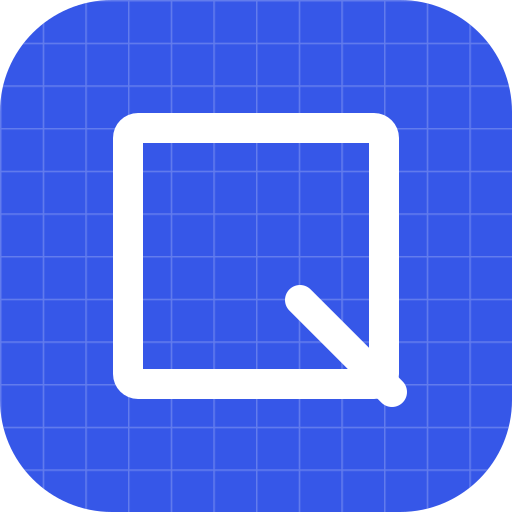

<p align="center">
  
</p>

<h1 align="center">Quadretto</h1>

<p align="center">
  <b>The notebook for computer-science students, with the Apple Pencil.</b><br>
  Handwriting, Markdown and LaTeX, runnable code (Python, JavaScript, C and C++) and course tools in the same page —<br>
  self-hosted, multi-user, and usable offline as a web app on the iPad.
</p>

> The interface is in **English** (default) and **Italian**. Some identifiers, diagram keywords and code samples are
> still Italian: Quadretto was born as one student's notebook for a Computer Engineering degree in Italy.

<!-- Screenshots and a short GIF (Pencil writing, LaTeX, code running) go here. -->

## What it does

- **Notebooks per course**, grouped by year, with an exam countdown; a study-plan profile to start from.
- **Block notes**: text, handwriting and photos in the same sheet; page templates (lecture, exercise, proof);
  links between notes (`[[title]]`) with backlinks.
- **Text**: Markdown, LaTeX formulas (KaTeX), syntax-highlighted code, checklists, definition/theorem boxes.
- **Handwriting** with the Apple Pencil: low-latency ink, pressure, highlighter, eraser, undo/redo, grid/lined/dotted
  paper; shapes that straighten when you hold the tip still; a shape tool with a Cartesian plane; lasso selection;
  pinch to zoom and an overview of the pages.
- **PDF**: import a PDF and annotate it with the Pencil.
- **Runnable code**: multi-file projects in the note. Python (Pyodide) and JavaScript run in the browser, in workers,
  even offline; C and C++ compile on the server inside a sandbox. Import and export as zip or from public GitHub repositories,
  and a full-screen IDE mode.
- **Course tools** for Operating Systems: CPU scheduling, mutex and starvation simulators, charts and OS diagrams.
- **Offline first**: every change is saved on the device (IndexedDB) and synced to the server from a queue; version
  history and a 30-day trash.
- **Multi-user**: every account sees only its own data.

## Quick start (Docker)

```bash
git clone https://github.com/not-ami/quadretto.git
cd quadretto
cp .env.example .env          # set POSTGRES_PASSWORD
docker compose up -d
docker compose exec app node server/admin.js create-user yourname "Your Name"
docker compose exec app cat /app/yourname.credentials     # first password; change it in the app
```

Then open <http://localhost:8790>. By default Quadretto listens only on this computer: to use it from an iPad,
put it behind HTTPS (below).

## HTTPS (needed on the iPad)

Safari keeps a web app working offline only in a secure context, so serve Quadretto over HTTPS, for example:

- **Tailscale**: `tailscale serve --bg --https=8791 http://127.0.0.1:8790` (only your devices can reach it);
- **Caddy** on a domain you own: `quadretto.example.com { reverse_proxy 127.0.0.1:8790 }`.

Then on the iPad: open the address in Safari → Share → **Add to Home Screen**.

## Manual install

Requirements: Node.js 26 and PostgreSQL 17 (the versions Quadretto is tested with), with a database and a user that owns it.

```bash
createdb quadretto
cd server && npm ci --omit=dev
cat > ../.env <<'EOF'
PGHOST=127.0.0.1
PGDATABASE=quadretto
PGUSER=quadretto
PGPASSWORD=...
EOF
node server.js                 # creates the tables on first start (schema.sql is idempotent)
node admin.js create-user yourname
```

## Configuration

Environment variables (or a `.env` file next to `server/`):

| variable | default | meaning |
|---|---|---|
| `PGHOST`, `PGPORT`, `PGDATABASE`, `PGUSER`, `PGPASSWORD` | — | PostgreSQL connection |
| `HOST`, `PORT` | `127.0.0.1`, `8790` | where the server listens |
| `ALLOW_SIGNUP` | `0` | `1` lets anyone who reaches the server create an account |
| `OWNER_USERNAME` | — | an owner account created at start-up **without a password**: whoever logs in first with that name chooses it. Use it only to adopt existing data, and log in right away |
| `RUN_SANDBOX` | `off` | `bwrap` turns on C/C++ execution (Linux, needs `bubblewrap`) |
| `HTTPS_URL` | — | your HTTPS address; visitors of the plain-HTTP address see a banner pointing to it |
| `TRUST_PROXY` | — | IPs of a reverse proxy in front (comma-separated), so login limits see real client addresses |

## Running C and C++ safely

C/C++ execution is **off** unless you set `RUN_SANDBOX=bwrap`. When on, each run happens in
[bubblewrap](https://github.com/containers/bubblewrap): no network, read-only `/usr`, a throw-away working folder,
CPU, memory, file and process limits, and a `systemd-run` scope when available. It is not available in the Docker image
(the sandbox needs privileges a container should not have). Only turn it on for people you trust: it runs their code
on your machine.

## Development

```bash
cd server && npm ci
PGHOST=127.0.0.1 PGPORT=5432 PGUSER=postgres PGPASSWORD=... PGDATABASE=quadretto_test npm test
```

The front end is plain JavaScript modules with no build step (`public/`); the server is Node.js with no framework
(`server/`). Main pieces: `public/js/app.js` (interface), `ink.js` (handwriting), `store.js` (local storage and sync
queue), `md.js` (Markdown and LaTeX), `code.js` (runnable code); `server/server.js` (API), `auth.js`, `run.js` (sandbox).

## Contributing

Bug reports and ideas are welcome as issues. Pull requests need the [Contributor License Agreement](CLA.md): see
[CONTRIBUTING.md](CONTRIBUTING.md). Security problems: see [SECURITY.md](SECURITY.md).

## License

[GNU AGPL-3.0](LICENSE). You may use, modify and share Quadretto; if you run a modified version for other people
over a network, you must offer them its source code. Third-party components: [THIRD_PARTY_NOTICES.md](THIRD_PARTY_NOTICES.md).
